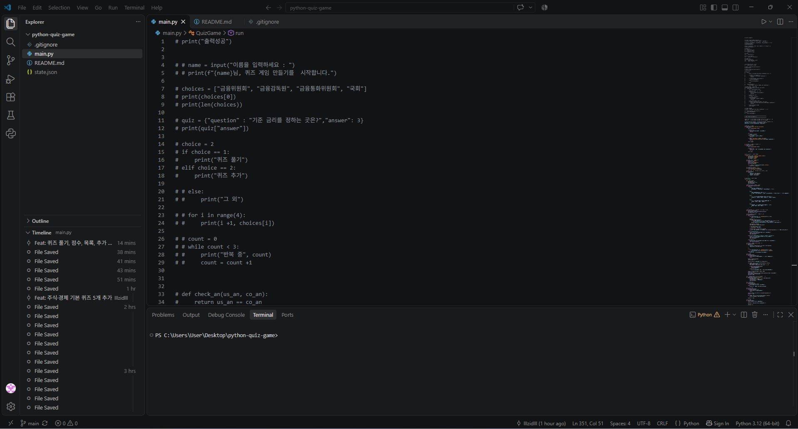
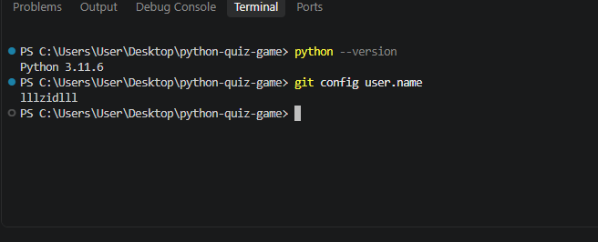
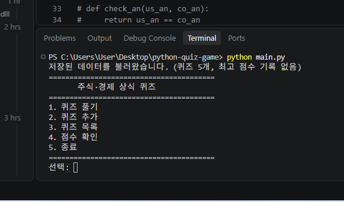
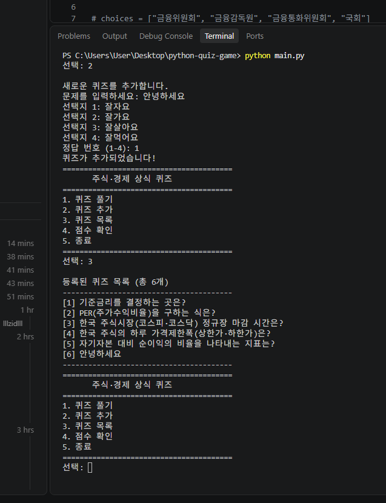
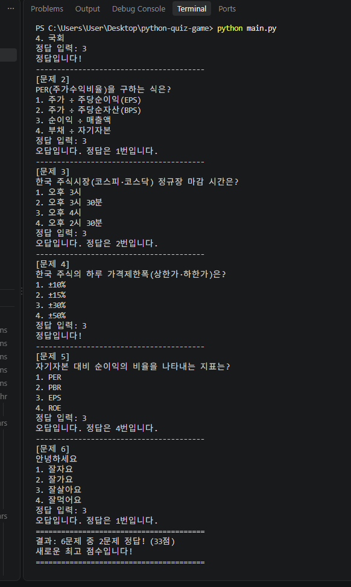
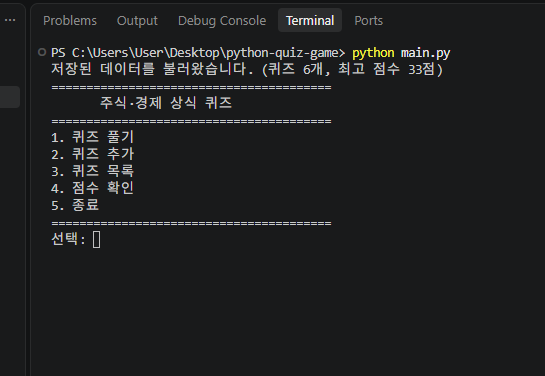
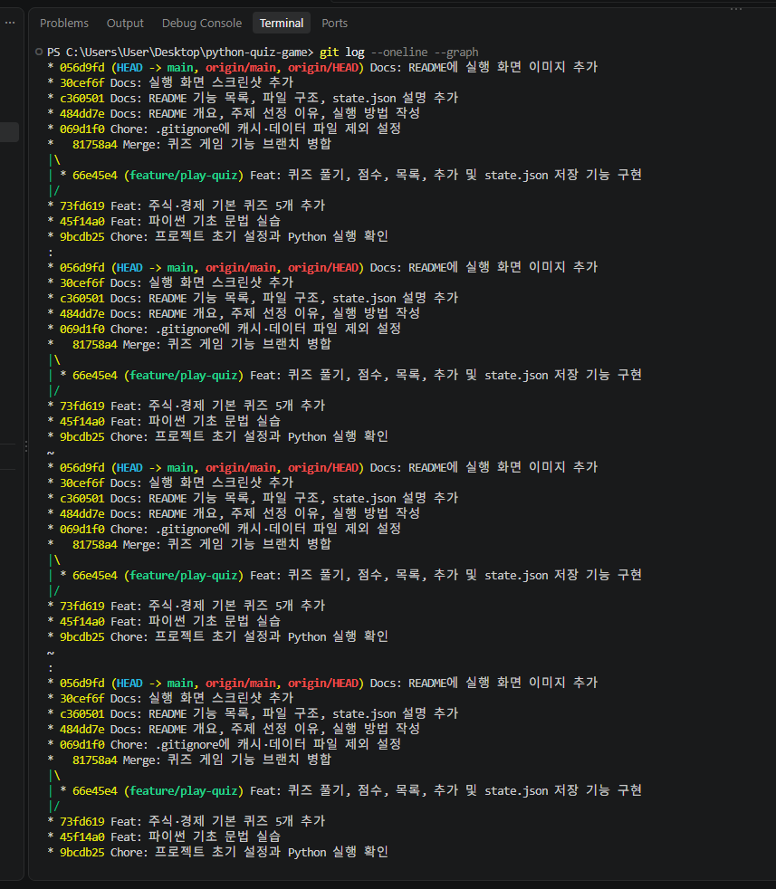

# 주식·경제 상식 퀴즈 게임

## 1. 프로젝트 개요
터미널에서 동작하는 Python 콘솔 퀴즈 게임입니다.
주식·경제 상식 문제를 풀고, 새로운 문제를 직접 추가할 수 있으며,
퀴즈와 최고 점수는 `state.json` 파일에 저장되어 프로그램을 다시 실행해도 유지됩니다.

- 개발 언어: Python 3.12 (표준 라이브러리만 사용)
- 개발 도구: Visual Studio Code, Git, GitHub
- 코디세이 입학연수 과제

## 2. 퀴즈 주제와 선정 이유
**주제: 주식·경제 상식**

기준금리, PER, ROE처럼 뉴스와 투자에서 자주 나오지만 헷갈리기 쉬운 개념을
퀴즈로 반복해서 익힐 수 있도록 이 주제를 선정했습니다.

## 3. 실행 방법
1. Python 3.10 이상이 설치되어 있어야 합니다.
2. 저장소를 내려받습니다.
   ```
   git clone https://github.com/lllzidlll/python-quiz-game.git
   cd python-quiz-game
   ```
3. 프로그램을 실행합니다.
   ```
   python main.py
   ```
   VS Code에서는 `main.py`를 연 뒤 `Ctrl + F5`로 실행할 수 있습니다.

## 4. 기능 목록
| 메뉴 | 기능 | 설명 |
|---|---|---|
| 1 | 퀴즈 풀기 | 등록된 퀴즈를 순서대로 출제하고 정답/오답과 최종 점수를 보여줍니다. 최고 점수를 넘으면 갱신합니다. |
| 2 | 퀴즈 추가 | 문제, 선택지 4개, 정답 번호를 입력받아 새 퀴즈를 등록하고 파일에 저장합니다. |
| 3 | 퀴즈 목록 | 등록된 퀴즈의 문제 목록을 번호와 함께 보여줍니다. |
| 4 | 점수 확인 | 저장된 최고 점수를 보여줍니다. 아직 풀지 않았다면 안내 메시지를 출력합니다. |
| 5 | 종료 | 데이터를 저장하고 프로그램을 종료합니다. |

**입력 및 예외 처리**
- 입력 앞뒤 공백을 제거한 뒤 처리합니다.
- 빈 입력, 숫자가 아닌 입력(예: `abc`), 범위 밖 숫자(예: `9`, `0`)는 안내 후 다시 입력받습니다.
- `Ctrl + C`(KeyboardInterrupt)나 입력 종료(EOFError)가 발생하면 데이터를 저장하고 안전하게 종료합니다.
- `state.json`이 없으면 기본 퀴즈로 시작하고, 손상되었으면 안내 후 기본 퀴즈로 복구합니다.

## 5. 파일 구조
```
python-quiz-game/
├── main.py          # 프로그램 전체 코드 (Quiz, QuizGame 클래스)
├── state.json       # 퀴즈·최고 점수 저장 파일 (실행 시 자동 생성, Git 제외)
├── README.md        # 프로젝트 설명
├── .gitignore       # Git에서 제외할 파일 목록
└── docs/
    └── screenshots/ # 실행 화면 스크린샷
```

**코드 구조 (main.py)**
| 구성 | 역할 |
|---|---|
| `read_number()` | 숫자 입력 검사 (빈칸·문자·범위) |
| `read_text()` | 글자 입력 검사 (빈칸) |
| `Quiz` 클래스 | 퀴즈 한 문제 (속성: question, choices, answer / 메서드: display, is_correct, to_dict) |
| `QuizGame` 클래스 | 게임 전체 관리 (속성: quizzes, best_score / 메서드: 메뉴, 풀기, 추가, 목록, 점수, 저장, 불러오기) |

## 6. 데이터 파일 설명 (state.json)
- **경로:** 프로젝트 루트 (`main.py`와 같은 폴더)의 `state.json`
- **인코딩:** UTF-8
- **역할:** 퀴즈 목록과 최고 점수를 저장해, 프로그램을 종료한 뒤 다시 실행해도 데이터가 유지되게 합니다.
- **저장 시점:** 퀴즈 추가 시, 최고 점수 갱신 시, 프로그램 종료 시

**스키마**
| 키 | 타입 | 설명 |
|---|---|---|
| `quizzes` | list | 퀴즈 목록 |
| `quizzes[].question` | str | 문제 |
| `quizzes[].choices` | list[str] | 선택지 4개 |
| `quizzes[].answer` | int | 정답 번호 (1~4) |
| `best_score` | int 또는 null | 최고 점수 (100점 만점), 기록이 없으면 null |

**예시**
```json
{
    "quizzes": [
        {
            "question": "기준금리를 결정하는 곳은?",
            "choices": ["금융위원회", "금융감독원", "금융통화위원회", "국회"],
            "answer": 3
        }
    ],
    "best_score": 80
}
```

## 7. 실행 화면

### 개발 환경




### 메뉴


### 잘못된 입력 처리


### 퀴즈 추가


### 퀴즈 풀기


### 점수 확인


### 재실행 후 데이터 유지


### Git 커밋 기록



## 8. Git 작업 기록

### 커밋 메시지 규칙
- 형식: `타입: 변경 내용 요약`
- 타입: `Feat`(기능 추가), `Fix`(버그 수정), `Docs`(문서), `Refactor`(구조 개선), `Chore`(설정), `Merge`(병합)
- 원칙: 기능 하나를 완성하고 실행 테스트를 통과한 뒤, 그 기능만 묶어서 커밋한다.

### 커밋 내역 (오래된 순, 이 문서 추가 전 기준 12개)
| 순서 | 해시 | 커밋 메시지 |
|---|---|---|
| 1 | 9bcdb25 | Chore: 프로젝트 초기 설정과 Python 실행 확인 |
| 2 | 45f14a0 | Feat: 파이썬 기초 문법 실습 |
| 3 | 73fd619 | Feat: 주식·경제 기본 퀴즈 5개 추가 |
| 4 | 66e45e4 | Feat: 퀴즈 풀기, 점수, 목록, 추가 및 state.json 저장 기능 구현 (feature/play-quiz 브랜치) |
| 5 | 81758a4 | Merge: 퀴즈 게임 기능 브랜치 병합 |
| 6 | 069d1f0 | Chore: .gitignore에 캐시·데이터 파일 제외 설정 |
| 7 | 484dd7e | Docs: README 개요, 주제 선정 이유, 실행 방법 작성 |
| 8 | c360501 | Docs: README 기능 목록, 파일 구조, state.json 설명 추가 |
| 9 | 30cef6f | Docs: 실행 화면 스크린샷 추가 |
| 10 | 056d9fd | Docs: README에 실행 화면 이미지 추가 |
| 11 | 7599fb4 | Docs: git log 그래프 스크린샷 추가 |
| 12 | 0993765 | Docs: README에 Git 실습 기록 추가 |

### 브랜치 전략과 병합
- 사용한 브랜치: `feature/play-quiz`
- 브랜치를 나눈 이유: 핵심 기능을 개발하는 동안 `main`은 항상 실행 가능한 상태로 유지하고, 기능이 완성되고 테스트를 통과한 뒤에만 합치기 위해서다.
- 병합 방법: `git checkout main` → `git merge --no-ff feature/play-quiz`로 병합 커밋 `81758a4`를 만들었다. `--no-ff`를 써서 브랜치에서 작업한 흐름이 기록에 남도록 했다.
- 병합 전 확인: 브랜치에서 메뉴 1~5번 실행 테스트를 통과했는지, `main`에 다른 변경이 없는지 확인했다.

```
*   81758a4 Merge: 퀴즈 게임 기능 브랜치 병합
|\
| * 66e45e4 (feature/play-quiz) Feat: 퀴즈 풀기, 점수, 목록, 추가 및 state.json 저장 기능 구현
|/
* 73fd619 Feat: 주식·경제 기본 퀴즈 5개 추가
* 45f14a0 Feat: 파이썬 기초 문법 실습
* 9bcdb25 Chore: 프로젝트 초기 설정과 Python 실행 확인
```

### clone / pull 실습
1. `git clone`으로 저장소를 바탕화면의 `quiz-clone` 폴더에 복제했다.
2. 작업 폴더에서 README를 수정해 커밋 `0993765`를 push했다.
3. 복제본 폴더에서 `git pull`로 그 변경을 받아와 README에 반영된 것을 확인했다.

## 9. 설계 설명

### 클래스로 나눈 이유
- `Quiz`는 문제 하나의 데이터(문제, 선택지, 정답)와 그 데이터로 하는 일(출력, 정답 확인, 저장용 변환)을 한곳에 묶는다.
- `QuizGame`은 게임 전체의 상태(퀴즈 목록, 최고 점수)와 흐름(메뉴, 풀기, 추가, 저장, 불러오기)을 담당한다.
- 함수만으로 만들면 퀴즈 데이터를 dict로 두고 모든 함수에 넘기거나 전역 변수로 공유해야 해서, 어디서 값이 바뀌는지 추적하기 어렵다. 클래스는 데이터와 기능이 함께 있고 `self`로 상태를 공유하므로, 수정할 때 그 클래스 안만 보면 된다.
- 입력 검사 함수(`read_number`, `read_text`)는 게임 상태와 관계가 없어서 클래스 밖에 두고, 메뉴 선택·정답 입력·퀴즈 추가에서 함께 재사용한다.

### 프로그램 시작 시 데이터 불러오기 순서
1. `state.json`을 읽어서 성공하면 그 데이터를 사용한다.
2. 파일이 없으면 기본 퀴즈 5개로 시작하고 새 파일을 만든다.
3. 파일이 손상되었으면(JSON 문법 오류, 키 누락, 선택지 4개가 아님, 정답이 1~4가 아님) 안내 후 기본 퀴즈로 복구하고 저장한다.
4. 권한 문제 등으로 파일을 읽을 수 없으면 기본 퀴즈로 시작한다.

### JSON을 선택한 이유와 한계
- 선택 이유: 표준 라이브러리 `json`만으로 저장할 수 있고, 사람이 파일을 열어 읽고 고칠 수 있으며, 퀴즈 목록(list) 안에 퀴즈 하나(dict)를 넣는 중첩 구조를 그대로 표현할 수 있다. 퀴즈마다 힌트 같은 항목을 추가하기도 쉽다.
- 한계:
  - 저장할 때마다 파일 전체를 다시 쓰므로 퀴즈가 수천 개로 늘어나면 느려진다.
  - 불러올 때 파일 전체를 메모리에 올리므로 대용량 데이터에는 맞지 않는다.
  - 형식(스키마)을 강제하지 않아서 직접 검사 코드를 작성해야 한다(`load_data`의 형식 검사).
  - 저장 도중 프로그램이 강제로 꺼지면 파일이 손상될 수 있다. 이 경우 다음 실행에서 기본 퀴즈로 복구된다.
  - 여러 사람이 동시에 쓰는 상황을 지원하지 않는다.
- 대안: 데이터가 많아지면 표준 라이브러리 `sqlite3` 같은 데이터베이스가 적합하다.

### 요구사항이 바뀔 때 수정할 곳
| 변경 내용 | 수정할 함수·메서드 |
|---|---|
| 기본 퀴즈 변경 | `create_default_quizzes()` |
| 입력 규칙 변경 | `read_number()`, `read_text()` |
| 저장 형식 변경 | `Quiz.to_dict()`, `load_data()`, `save_data()` |
| 점수 계산 방식 변경 | `play_quiz()`, `update_best_score()` |
| 메뉴 추가 | `show_menu()`, `run()` |