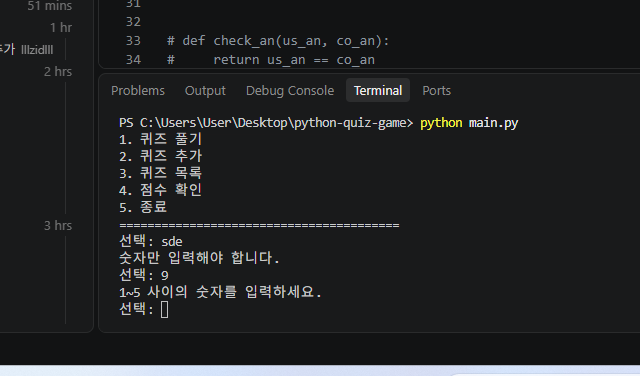
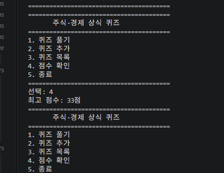

# 주식·경제 상식 퀴즈 게임

## 1. 프로젝트 개요
터미널에서 동작하는 Python 콘솔 퀴즈 게임입니다.
주식·경제 상식 문제를 풀고, 새로운 문제를 직접 추가할 수 있으며,
퀴즈와 최고 점수는 `state.json` 파일에 저장되어 프로그램을 다시 실행해도 유지됩니다.

- 개발 언어: Python 3.12 (표준 라이브러리만 사용)
- 개발 도구: Visual Studio Code, Git, GitHub
- 코디세이 입학연수 과제

## 2. 퀴즈 주제와 선정 이유
**주제: 주식·경제 상식**

기준금리, PER, ROE처럼 뉴스와 투자에서 자주 나오지만 헷갈리기 쉬운 개념을
퀴즈로 반복해서 익힐 수 있도록 이 주제를 선정했습니다.

## 3. 실행 방법
1. Python 3.10 이상이 설치되어 있어야 합니다.
2. 저장소를 내려받습니다.
   ```
   git clone https://github.com/lllzidlll/python-quiz-game.git
   cd python-quiz-game
   ```
3. 프로그램을 실행합니다.
   ```
   python main.py
   ```
   VS Code에서는 `main.py`를 연 뒤 `Ctrl + F5`로 실행할 수 있습니다.

## 4. 기능 목록
| 메뉴 | 기능 | 설명 |
|---|---|---|
| 1 | 퀴즈 풀기 | 등록된 퀴즈를 순서대로 출제하고 정답/오답과 최종 점수를 보여줍니다. 최고 점수를 넘으면 갱신합니다. |
| 2 | 퀴즈 추가 | 문제, 선택지 4개, 정답 번호를 입력받아 새 퀴즈를 등록하고 파일에 저장합니다. |
| 3 | 퀴즈 목록 | 등록된 퀴즈의 문제 목록을 번호와 함께 보여줍니다. |
| 4 | 점수 확인 | 저장된 최고 점수를 보여줍니다. 아직 풀지 않았다면 안내 메시지를 출력합니다. |
| 5 | 종료 | 데이터를 저장하고 프로그램을 종료합니다. |

**입력 및 예외 처리**
- 입력 앞뒤 공백을 제거한 뒤 처리합니다.
- 빈 입력, 숫자가 아닌 입력(예: `abc`), 범위 밖 숫자(예: `9`, `0`)는 안내 후 다시 입력받습니다.
- `Ctrl + C`(KeyboardInterrupt)나 입력 종료(EOFError)가 발생하면 데이터를 저장하고 안전하게 종료합니다.
- `state.json`이 없으면 기본 퀴즈로 시작하고, 손상되었으면 안내 후 기본 퀴즈로 복구합니다.

## 5. 파일 구조
```
python-quiz-game/
├── main.py          # 프로그램 전체 코드 (Quiz, QuizGame 클래스)
├── state.json       # 퀴즈·최고 점수 저장 파일 (실행 시 자동 생성, Git 제외)
├── README.md        # 프로젝트 설명
├── .gitignore       # Git에서 제외할 파일 목록
└── docs/
    └── screenshots/ # 실행 화면 스크린샷
```

**코드 구조 (main.py)**
| 구성 | 역할 |
|---|---|
| `read_number()` | 숫자 입력 검사 (빈칸·문자·범위) |
| `read_text()` | 글자 입력 검사 (빈칸) |
| `Quiz` 클래스 | 퀴즈 한 문제 (속성: question, choices, answer / 메서드: display, is_correct, to_dict) |
| `QuizGame` 클래스 | 게임 전체 관리 (속성: quizzes, best_score / 메서드: 메뉴, 풀기, 추가, 목록, 점수, 저장, 불러오기) |

## 6. 데이터 파일 설명 (state.json)
- **경로:** 프로젝트 루트 (`main.py`와 같은 폴더)의 `state.json`
- **인코딩:** UTF-8
- **역할:** 퀴즈 목록과 최고 점수를 저장해, 프로그램을 종료한 뒤 다시 실행해도 데이터가 유지되게 합니다.
- **저장 시점:** 퀴즈 추가 시, 최고 점수 갱신 시, 프로그램 종료 시

**스키마**
| 키 | 타입 | 설명 |
|---|---|---|
| `quizzes` | list | 퀴즈 목록 |
| `quizzes[].question` | str | 문제 |
| `quizzes[].choices` | list[str] | 선택지 4개 |
| `quizzes[].answer` | int | 정답 번호 (1~4) |
| `best_score` | int 또는 null | 최고 점수 (100점 만점), 기록이 없으면 null |

**예시**
```json
{
    "quizzes": [
        {
            "question": "기준금리를 결정하는 곳은?",
            "choices": ["금융위원회", "금융감독원", "금융통화위원회", "국회"],
            "answer": 3
        }
    ],
    "best_score": 80
}
```

## 7. 실행 화면

### 개발 환경


### 메뉴


### 잘못된 입력 처리


### 퀴즈 추가


### 퀴즈 풀기


### 점수 확인


### 재실행 후 데이터 유지
